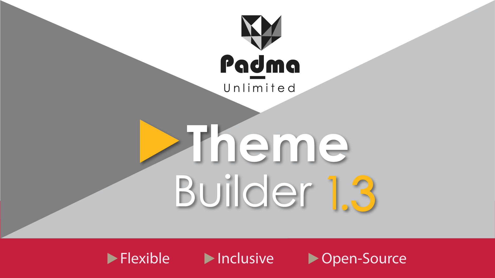

# PS Padma ContentBuilder

[Deutsch](README.md) | **English**

[](readme.txt)


[](https://www.gnu.org/licenses/gpl-2.0.html)



**PS Padma** is a visual theme and template builder for WordPress and
ClassicPress. It combines a flexible drag-and-drop grid with an extensive block
library, making it possible to build custom websites without requiring external
page-builder plugins.

## Highlights

### Visual editor

- Create layouts directly in the browser with a **drag-and-drop grid**
- Adjust spacing, colors, typography, and other design properties with
  **point-and-click** controls
- Manage content, templates, and layout variants in the editor
- Preview changes in the context of the actual website instead of configuring
  settings blindly

### Built-in blocks

PS Padma includes blocks for common website areas, including:

- Headers, footers, navigation, search, and site logos
- Text, images, video, audio, galleries, and social media
- Content, listings, breadcrumbs, widget areas, and forms
- Accordions, tabs, buttons, columns, sliders, portfolios, and hero sections
- Cards, card grids, quotes, spoilers, and many additional extensions

### Shortcode workflow

- Assemble and configure shortcodes in the builder
- Save reusable presets for consistent components
- Use custom color palettes and icon selection in the generator
- Edit nested content and shortcodes in the visual editor

### Built for projects

- Works with **WordPress** and **ClassicPress**
- Does not require an additional builder plugin
- Uses a local, maintainable theme structure with PHP, CSS, and JavaScript
  assets
- Includes ongoing security and quality improvements
- Can be extended with **PS SEO** for metadata, structured data, and sitemap
  filters

## Requirements

| Component | Requirement |
| --- | --- |
| WordPress | 5.0 or later |
| ClassicPress | 2.7.0 or later |
| PHP | 8.0 or later |
| Recommended `memory_limit` | 256M or higher |
| Recommended `post_max_size` | 32M or higher |

## Quick start

1. Download this repository or provide the theme as a ZIP archive.
2. Copy the directory to `wp-content/themes/`, or upload the ZIP from
   **Appearance > Themes > Add New Theme**.
3. Activate **PS Padma ContentBuilder**.
4. Open the PS Padma pages in the administration area.
5. Start the visual editor, create a layout, and place blocks.

## Security

PS Padma is actively maintained and hardens dynamic content, URLs, and legacy
dependencies. To disable PHP processing in applicable blocks, add the following
to `wp-config.php`:

```php
define('PADMA_DISABLE_PHP_PARSING', false);
```

## Documentation and support

- [Documentation](https://power-source.github.io/ps-padma/)
- [Issues and feedback](https://github.com/Power-Source/ps-padma/issues)
- [Releases](https://github.com/Power-Source/ps-padma/releases)
- [PSOURCE Manager](https://github.com/Power-Source/ps-update-manager/releases)

## License

PS Padma is licensed under the
[GNU General Public License v2.0 or later](LICENSE).
